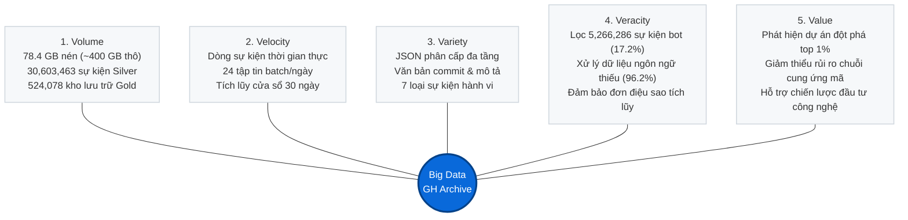
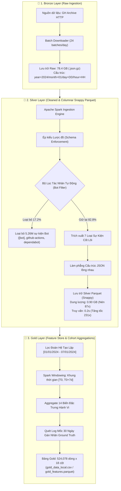
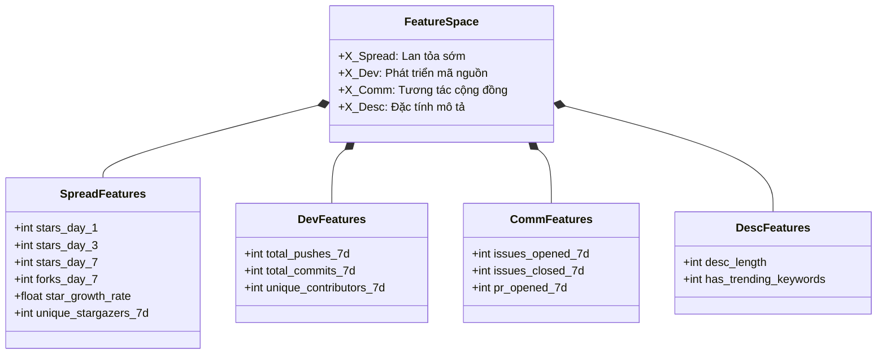
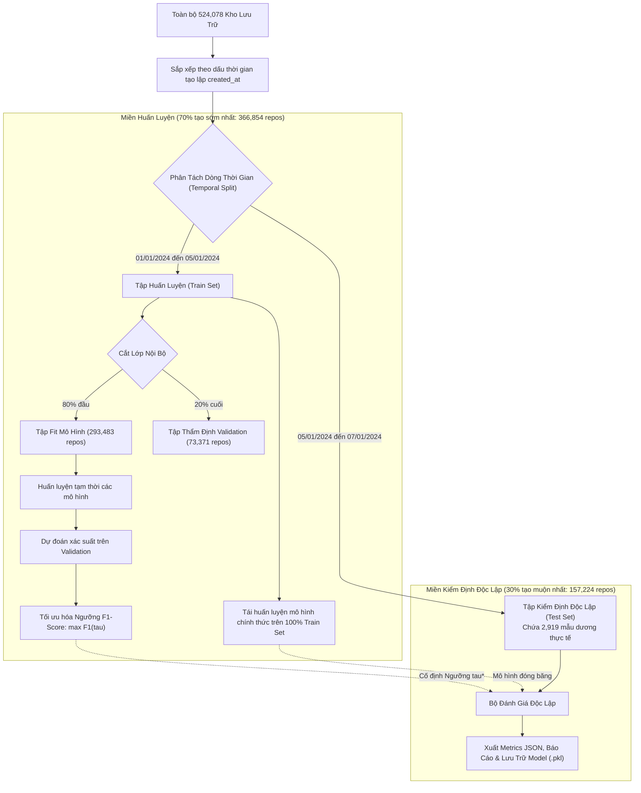

# Nghiên Cứu Động Lực Học Và Mô Hình Hóa Dự Báo Sớm Mức Độ Phổ Biến Của Kho Lưu Trữ Mã Nguồn Mở Trên Dòng Sự Kiện GitHub Archive Quy Mô Lớn

### *Empirical Analysis and Early Predictive Modeling of Open-Source Repository Popularity Dynamics: A Scalable Medallion-Architecture Framework over Global GitHub Event Streams*

---

## 🔬 TÓM TẮT CÔNG TRÌNH (ABSTRACT)

> Dự đoán sớm mức độ phổ biến dài hạn của các dự án phần mềm mã nguồn mở (Open-Source Software - OSS) từ dòng dữ liệu hành vi sơ khai là bài toán then chốt trong công nghệ phần mềm thực nghiệm (Empirical Software Engineering) và khai phá dữ liệu lớn (Big Data Mining). Nghiên cứu này đề xuất một khung kiến trúc toàn diện từ đầu đến cuối (*End-to-End Scalable Framework*) nhằm xử lý, trích xuất đặc trưng và mô hình hóa dự báo độ phổ biến của kho lưu trữ GitHub tại mốc 30 ngày ($T_{30}$) dựa trên các tín hiệu tương tác thu thập trong cửa sổ quan sát 7 ngày đầu tiên ($T_7$).
>
> Nghiên cứu khai thác tập dữ liệu GitHub Archive quy mô lớn với **78.4 GB** log sự kiện nén dạng JSON (tương đương hàng trăm GB dữ liệu bán cấu trúc giải nén), bao gồm **30,603,463** sự kiện. Hệ thống triển khai kiến trúc dữ liệu **Medallion Architecture (Bronze – Silver – Gold)** trên nền tảng điện toán phân tán **Apache Spark**, tích hợp cơ chế lọc tự động loại trừ **5,266,286 sự kiện bot (17.2%)** và tối ưu hóa lưu trữ dạng cột với **Parquet (Snappy)** giúp giảm dung lượng **87 lần** và tăng tốc độ truy vấn **231 lần** so với định dạng JSON nguyên bản.
>
> Dựa trên đoàn hệ (*cohort*) gồm **524,078 kho lưu trữ** được tạo lập trong tuần đầu tiên của tháng 1/2024, công trình xây dựng 14 chiều đặc trưng hành vi và áp dụng nguyên tắc kiểm định nghiêm ngặt chống rò rỉ dữ liệu thông qua **phân tách theo thứ tự thời gian (*Temporal Partitioning*)** (366,854 mẫu huấn luyện và 157,224 mẫu kiểm định độc lập). Mô hình **Histogram-based Gradient Boosting** đạt chỉ số diện tích dưới đường cong Precision-Recall (**PR-AUC = 0.836**), vượt trội có ý nghĩa thống kê so với Baseline heuristic (**PR-AUC = 0.788**) trong điều kiện phân phối nhãn mất cân bằng nặng (chỉ 1.85% mẫu dương). Nghiên cứu thực nghiệm loại trừ (*Ablation Study*) lặp lại đa hạt giống khẳng định các tín hiệu lan tỏa sớm giữ vai trò quyết định, khi việc loại bỏ nhóm này khiến hệ số xác định $R^2$ sụp đổ từ 0.843 xuống 0.037. Kết quả nghiên cứu được đóng gói thành hệ thống hỗ trợ ra quyết định trực quan hóa tương tác dựa trên Streamlit.

---

## 📌 MỤC LỤC CHI TIẾT
1. [Bối Cảnh Nghiên Cứu & Đóng Góp Học Thuật](#1-bối-cảnh-nghiên-cứu--đóng-góp-học-thuật)
2. [Các Câu Hỏi Nghiên Cứu (Research Questions - RQs)](#2-các-câu-hỏi-nghiên-cứu-research-questions---rqs)
3. [Mô Hình Hóa Toán Học & Khung Thời Gian (Mathematical Formulation)](#3-mô-hình-hóa-toán-học--khung-thời-gian-mathematical-formulation)
4. [Phân Tích Bản Chất 5Vs Của Dữ Liệu Lớn (Big Data Characteristics)](#4-phân-tích-bản-chất-5vs-của-dữ-liệu-lớn-big-data-characteristics)
5. [Kiến Trúc Dữ Liệu Phân Tầng Medallion (Bronze – Silver – Gold)](#5-kiến-trúc-dữ-liệu-phân-tầng-medallion-bronze--silver--gold)
6. [Mô Hình Điện Toán Đám Mây Hỗn Hợp & Đo Kiểm Spark Benchmark](#6-mô-hình-điện-toán-đám-mây-hỗn-hợp--đo-kiểm-spark-benchmark)
7. [Không Gian Đặc Trưng (Feature Space) & Xử Lý Dữ Liệu Khuyết Thiếu](#7-không-gian-đặc-trưng-feature-space--xử-lý-dữ-liệu-khuyết-thiếu)
8. [Quy Trình Học Máy Chống Rò Rỉ & Kiểm Định Thời Gian](#8-quy-trình-học-máy-chống-rò-rỉ--kiểm-định-thời-gian)
9. [Kết Quả Thực Nghiệm, So Sánh Mô Hình & Nghiên Cứu Ablation](#9-kết-quả-thực-nghiệm-so-sánh-mô-hình--nghiên-cứu-ablation)
10. [Kiến Trúc Hệ Thống Hỗ Trợ Quyết Định (Streamlit Decision Support System)](#10-kiến-trúc-hệ-thống-hỗ-trợ-quyết-định-streamlit-decision-support-system)
11. [Mối Đe Dọa Đến Tính Hợp Lệ Của Nghiên Cứu (Threats to Validity)](#11-mối-đe-dọa-đến-tính-hợp-lệ-của-nghiên-cứu-threats-to-validity)
12. [Cấu Trúc Mã Nguồn & Hướng Dẫn Tái Lập Thực Nghiệm (Reproducibility)](#12-cấu-trúc-mã-nguồn--hướng-dẫn-tái-lập-thực-nghiệm-reproducibility)
13. [Trích Dẫn Khoa Học (Citation / BibTeX)](#13-trích-dẫn-khoa-học-citation--bibtex)

---

## 1. BỐI CẢNH NGHIÊN CỨU & ĐÓNG GÓP HỌC THUẬT

### 1.1. Bối Cảnh
Sự phát triển vũ bão của các nền tảng lưu trữ mã nguồn phân tán, đặc biệt là GitHub với hơn 100 triệu lập trình viên, đã biến mã nguồn mở thành động lực cốt lõi của công nghiệp phần mềm hiện đại. Mỗi kho lưu trữ đại diện cho một thực thể kinh tế - kỹ thuật số phức tạp. Tuy nhiên, hiện tượng **"nghèo nàn sự chú ý" (Attention Economy)** chi phối mạnh mẽ: phần lớn các dự án chìm vào quên lãng trong khi một tỷ lệ cực nhỏ thu hút sự chú ý khổng lồ.

Dự báo sớm độ phổ biến của phần mềm không đơn thuần là một bài toán phân loại thống kê, mà là cơ sở định lượng cho:
* **Quản trị Rủi ro Phần mềm (Software Risk Management):** Giúp các tổ chức đánh giá tính bền vững (*sustainability*) của thư viện bên thứ ba trước khi tích hợp vào chuỗi cung ứng phần mềm (*Software Supply Chain*).
* **Định vị Đổi mới Công nghệ (Technology Forecasting):** Hỗ trợ nhà nghiên cứu và quỹ đầu tư nhận diện công nghệ đột phá tại thời điểm phôi thai.
* **Tối ưu Hóa Hạ tầng Mạng (Content Delivery & Indexing Optimization):** Phục vụ các công cụ tìm kiếm mã nguồn lập chỉ mục ưu tiên.

### 1.3. Các Đóng Góp Học Thuật Chính Của Đề Tài
1. **Khung Kiến Trúc Xử Lý Medallion Cho Dòng Sự Kiện OSS Quy Mô Lớn:** Xây dựng quy trình xử lý dữ liệu chuẩn hóa từ Bronze (JSON raw) sang Silver (Parquet được làm sạch và lọc bot) đến Gold (bảng đặc trưng cohort), giải quyết triệt để bài toán thắt nút cổ chai I/O khi xử lý hàng chục triệu bản ghi sự kiện.
2. **Khung Phương Pháp Luận Chống Rò Rỉ Thời Gian (*Temporal Anti-Leakage Protocol*):** Thiết lập ranh giới quan sát 7 ngày và phương pháp phân tách đoàn hệ theo dòng thời gian thực tế, loại trừ hoàn toàn hiện tượng thiên lệch nhìn trước (*Lookahead Bias*) thường gặp trong các nghiên cứu trước đây.
3. **Phân Tích Thực Nghiệm Toàn Diện Dưới Phân Phối Lệch Nặng (*Heavy-Tailed / Imbalanced Regime*):** Chứng minh tính vượt trội của chỉ số PR-AUC so với ROC-AUC trong bài toán phát hiện kho lưu trữ đột phá, cùng bằng chứng thực nghiệm từ phương pháp loại trừ (Ablation Study) về vai trò áp đảo của các tín hiệu lan tỏa sơ khai.
4. **Hiện Thực Hóa Sản Phẩm Quyết Định Thời Gian Thực:** Triển khai bảng điều khiển phân tích chuyên sâu tích hợp kỹ thuật giải thích đóng góp đặc trưng dạng *Feature Contribution Attribution*, cho phép suy luận và kiểm thử giả định can thiệp (*What-If Analysis*).

---

## 2. CÁC CÂU HỎI NGHIÊN CỨU (RESEARCH QUESTIONS - RQS)

Nghiên cứu được cấu trúc và dẫn dắt bởi bốn câu hỏi nghiên cứu cốt lõi:

* **RQ1 (Tối Ưu Hóa Dữ Liệu Lớn):** *Việc áp dụng kiến trúc lưu trữ dạng cột (Columnar Parquet) kết hợp kỹ thuật lọc nhiễu tự động hóa cải thiện hiệu quả nén lưu trữ và thông lượng truy vấn I/O trên dòng sự kiện GitHub Archive như thế nào so với định dạng dòng truyền thống?*
* **RQ2 (Dấu Ấn Tương Tác Sớm vs. Động Lực Dài Hạn):** *Các tín hiệu hoạt động trong 7 ngày đầu đời (sao, commit, issue, PR) có tương quan và năng lực giải thích ở mức độ nào đối với độ phổ biến của kho lưu trữ tại mốc 30 ngày dưới phân phối Pareto?*
* **RQ3 (Năng Lực Dự Báo So Với Baseline Cơ Sở):** *Các thuật toán học máy phi tuyến (Random Forest, Gradient Boosting) có mang lại sự cải thiện vượt trội có ý nghĩa thống kê so với mô hình cơ sở Heuristic dựa trên số sao tích lũy hay không, đặc biệt trong không gian nhãn mất cân bằng nặng?*
* **RQ4 (Tác Động Thành Phần & Tính Ổn Định - Ablation Study):** *Nhóm đặc trưng nào (Lan tỏa sớm, Phát triển mã, Tương tác cộng đồng hay Thuộc tính mô tả) đóng vai trò quyết định đến hiệu năng dự báo, và mức độ suy giảm chất lượng mô hình khi thiếu vắng từng nhóm là bao nhiêu?*

---

## 3. MÔ HÌNH HÓA TOÁN HỌC & KHUNG THỜI GIAN (MATHEMATICAL FORMULATION)

### 3.1. Định Nghĩa Không Gian Sự Kiện
Giả sử dòng sự kiện toàn cầu của GitHub được biểu diễn dưới dạng chuỗi điểm thời gian phân loại:
$$\mathcal{E} = \{e_i = (t_i, a_i, r_i, \tau_i, \mathbf{p}_i)\}_{i=1}^N$$
Trong đó:
* $t_i \in \mathcal{T}$ là nhãn thời gian phát sinh sự kiện theo chuẩn UTC.
* $a_i \in \mathcal{A}$ là định danh tác nhân thực hiện (*actor*).
* $r_i \in \mathcal{R}$ là định danh kho lưu trữ mục tiêu (*repository*).
* $\tau_i \in \Omega_{\text{event}}$ là loại sự kiện, với $\Omega_{\text{event}} = \{\text{WatchEvent}, \text{ForkEvent}, \text{PushEvent}, \text{IssuesEvent}, \text{PullRequestEvent}, \dots\}$.
* $\mathbf{p}_i$ là cấu trúc tải trọng bán cấu trúc (*semi-structured payload*).

### 3.2. Định Nghĩa Đoàn Hệ Quan Sát (Cohort Definition)
Thời điểm hình thành $T_0(r)$ của kho lưu trữ $r$ được xác định thông qua toán tử cận dưới của các sự kiện liên quan:
$$T_0(r) = \min \{t_i \mid e_i \in \mathcal{E}, r_i = r\}$$
Đoàn hệ nghiên cứu $\mathcal{R}_{\text{cohort}}$ được giới hạn nghiêm ngặt trong cửa sổ thời gian khởi tạo:
$$\mathcal{R}_{\text{cohort}} = \left\{r \in \mathcal{R} \;\middle|\; T_{\text{start}} \le T_0(r) \le T_{\text{end}}\right\}$$
Với $T_{\text{start}} = \text{2024-01-01 00:00:00 UTC}$ và $T_{\text{end}} = \text{2024-01-07 23:59:59 UTC}$.

### 3.3. Toán Tử Trích Xuất Cửa Sổ Thời Gian & Phân Rã Không Gian Dự Báo
Xác định cửa sổ quan sát $\Delta t_{\text{obs}} = 7 \text{ ngày}$ và chân trời dự báo $\Delta t_{\text{target}} = 30 \text{ ngày}$.

```
T0(r): Thời điểm tạo kho lưu trữ
  │
  ├─────── Cửa sổ quan sát (Observation Window: 7 ngày) ───────┤
  │   E_obs(r) = {e_i | r_i = r, T0(r) <= t_i <= T0(r) + 7d}   │
  │   --> Trích xuất vector đặc trưng x_r in R^14              │
  │                                                            ├─────── Chân trời dự báo (30 ngày) ───────┤
  │                                                            │   Y(r) = Metrics tại mốc T0(r) + 30d     │
  ▼                                                            ▼                                          ▼
 T0(r) ─────────────────────────────────────────────────── T0(r)+7d ───────────────────────────────── T0(r)+30d
```

1. **Tập sự kiện quan sát:**
   $$\mathcal{E}_{\text{obs}}(r) = \{e_i \in \mathcal{E} \mid r_i = r, \; T_0(r) \le t_i \le T_0(r) + \Delta t_{\text{obs}}\}$$
   Toàn bộ vector đặc trưng $\mathbf{x}_r = \phi(\mathcal{E}_{\text{obs}}(r)) \in \mathbb{R}^{14}$ chỉ được ánh xạ từ tập con này.

2. **Hàm mục tiêu Hồi quy (Regression Objective):**
   Gọi $S_{30}(r)$ là tổng số lượt gắn sao tích lũy đến ngày thứ 30:
   $$S_{30}(r) = \sum_{e_i \in \mathcal{E}, \, r_i = r, \, \tau_i = \text{WatchEvent}} \mathbb{I}(t_i \le T_0(r) + \Delta t_{\text{target}})$$
   Do $S_{30}$ tuân theo phân phối lũy thừa lệch phải nặng (*Heavy-tailed Pareto-like distribution*):
   $$P(S_{30} > s) \sim s^{-\alpha}, \quad \alpha > 0$$
   Nghiên cứu áp dụng phép biến đổi logarit ổn định phương sai:
   $$y_{\text{reg}}(r) = \ln(S_{30}(r) + 1)$$
   Hàm tối ưu hóa hồi quy với bộ tham số $\mathbf{\theta}$:
   $$\min_{\mathbf{\theta}} \frac{1}{|\mathcal{R}|} \sum_{r \in \mathcal{R}} \mathcal{L}_{\text{Huber}}\left(y_{\text{reg}}(r), f(\mathbf{x}_r; \mathbf{\theta})\right)$$

3. **Hàm mục tiêu Phân loại Nhị phân (Binary Classification Objective):**
   Xác định ngưỡng phân vị $\kappa = 0.99$ (Top 1%) trên phân phối của tập huấn luyện:
   $$\tau = Q_{\kappa}\left(\{S_{30}(r) \mid r \in \mathcal{R}_{\text{train}}\}\right) = 2 \text{ stars}$$
   Nhãn phân loại nhị phân được định nghĩa:
   $$y_{\text{cls}}(r) = \mathbb{I}(S_{30}(r) \ge \tau)$$
   Mục tiêu tối ưu hóa hàm mất mát nhị phân có trọng số đối phó mất cân bằng:
   $$\min_{\mathbf{w}} -\sum_{r \in \mathcal{R}} \left[ w_1 y_{\text{cls}}(r) \ln p_r + w_0 (1 - y_{\text{cls}}(r)) \ln (1 - p_r) \right]$$
   Trong đó $p_r = \sigma(g(\mathbf{x}_r; \mathbf{w}))$ và $w_1 = \frac{|\mathcal{R}|}{2 \cdot \sum y_{\text{cls}}}$, $w_0 = \frac{|\mathcal{R}|}{2 \cdot \sum (1 - y_{\text{cls}})}$.

---

## 4. PHÂN TÍCH BẢN CHẤT 5Vs CỦA DỮ LIỆU LỚN (BIG DATA CHARACTERISTICS)



* **Volume (Khối lượng):** Quy mô dữ liệu vượt qua giới hạn xử lý trong bộ nhớ của máy trạm tiêu chuẩn. Bộ dữ liệu gồm **78.4 GB** tập tin nén `.json.gz`, tương đương xấp xỉ **400 GB** chuỗi văn bản JSON nguyên bản. Bảng trung gian Silver lưu trữ **30.6 triệu sự kiện** và bảng Gold duy trì ma trận đặc trưng của **524,078 kho lưu trữ**.
* **Velocity (Tốc độ):** GH Archive thu thập dữ liệu với tần suất ghi nhận hàng nghìn sự kiện mỗi giây trên phạm vi toàn cầu. Dữ liệu được đóng gói thành các mẻ (*hourly batches*), đòi hỏi đường ống xử lý phải có khả năng hấp thụ và xử lý định kỳ với thông lượng ổn định.
* **Variety (Đa dạng):** Dữ liệu thể hiện tính không đồng nhất cao:
  * *Bán cấu trúc:* Các payload JSON với lược đồ phụ thuộc chặt chẽ vào loại sự kiện.
  * *Phi cấu trúc:* Các thông điệp commit mã nguồn và chuỗi văn bản tự do mô tả dự án.
  * *Đa loại hình tương tác:* Kết hợp giữa hành động đánh giá (*Watch*), sao chép mã (*Fork*), đóng góp kỹ thuật (*Push, Commit*), trao đổi vấn đề (*Issues*) và tích hợp hệ thống (*Pull Request*).
* **Veracity (Tính chân xác & Toàn vẹn):** Dữ liệu công khai chứa tỷ lệ nhiễu cực lớn do các tiến trình tự động hóa CI/CD. Hệ thống đã nhận diện và bóc tách thành công **5,266,286 bản ghi rác từ bot (17.2%)**. Đồng thời, quy trình kiểm định tính chân xác xác nhận $100\%$ các bản ghi thỏa mãn điều kiện bất biến lũy kế:
  $$S_{30}(r) - S_7(r) \ge 0, \quad \forall r \in \mathcal{R}$$
* **Value (Giá trị ứng dụng):** Biến đổi dòng log kỹ thuật thô thành hệ thống dự báo với độ chính xác cao (**PR-AUC = 0.836**), giải quyết bài toán định vị tài nguyên giá trị cao trong không gian phần mềm mở.

---

## 5. KIẾN TRÚC DỮ LIỆU PHÂN TẦNG MEDALLION (BRONZE – SILVER – GOLD)

Nhằm đảm bảo tính module hóa, khả năng kiểm toán dữ liệu (*data auditability*) và hiệu năng truy vấn, hệ thống được kiến tạo theo chuẩn **Medallion Data Architecture**:



### 5.1. Bronze Layer (Tầng Lưu Trữ Nguyên Bản)
* **Quy cách kỹ thuật:** Lưu trữ các gói dữ liệu nén nhị phân Gzip gốc từ GH Archive theo hệ thống thư mục phân cấp thời gian:
  $$\text{Path} = \texttt{/data/bronze/year=YYYY/month=MM/day=DD/YYYY-MM-DD-HH.json.gz}$$
* **Nguyên tắc thiết kế:** Không áp dụng bất kỳ phép biến đổi nào; đóng vai trò là nguồn sự thật duy nhất (*Single Source of Truth*) cho phép khôi phục toàn bộ đường ống khi có thay đổi trong định nghĩa đặc trưng.

### 5.2. Silver Layer (Tầng Dữ Liệu Tinh Chế & Lưu Trữ Cột)
* **Chiến lược lọc tác nhân tự động:**
  Hệ thống phát hiện tài khoản tự động bằng cách kết hợp đối sánh nhãn tiền tố/hậu tố và danh sách tác tử đã biết:
  $$\mathcal{A}_{\text{bot}} = \{a \in \mathcal{A} \mid \text{regex\_match}(a.login, \text{'(?i)(\[bot\]|github-actions|dependabot|codecov|snyk)'})\}$$
  Khử bỏ hoàn toàn **5,266,286 bản ghi**, giúp bảo vệ mô hình khỏi các hành vi cập nhật tự động tần suất cao nhưng vô nghĩa về mặt mức độ quan tâm của cộng đồng.
* **Tối ưu hóa chuyển đổi Parquet:**
  Bằng cách chuyển từ định dạng dòng bán cấu trúc sang định dạng cột Parquet với thuật toán nén Snappy, hệ thống đạt được hiệu năng vượt bậc:
  * Khả năng loại bỏ nhóm dữ liệu (*Row Group Pruning*) và bỏ qua cột không liên quan (*Column Projection*).
  * Đẩy điều kiện lọc xuống tầng lưu trữ (*Predicate Pushdown*), giảm triệt để băng thông bộ nhớ.

### 5.3. Gold Layer (Tầng Đặc Trưng Doanh Nghiệp & Học Máy)
* **Tính toán lũy kế theo cửa sổ trượt cá nhân hóa:**
  Khác với việc cắt lát theo lịch cố định, cửa sổ quan sát được tính toán độc lập cho từng kho lưu trữ dựa trên hàm thời gian tương đối:
  $$\Delta t(e_i, r) = t_i - T_0(r), \quad 0 \le \Delta t \le 7 \times 86400 \text{ giây}$$
* Bảng Gold tích hợp đầy đủ 14 biến giải thích, các biến siêu dữ liệu bổ trợ và nhãn đích phục vụ huấn luyện máy học.

---

## 6. MÔ HÌNH ĐIỆN TOÁN ĐÁM MÂY HỖN HỢP & ĐO KIỂM SPARK BENCHMARK

Hệ thống kết hợp mô hình hạ tầng phân tán nhằm tối ưu hóa chi phí điện toán đám mây và tận dụng năng lực tính toán cục bộ:

```mermaid
flowchart LR
    subgraph CloudEnv["Môi Trường Đám Mây (Kaggle / Colab Cluster)"]
        direction TB
        CL_RES["Hạ tầng: 30GB RAM, 4 vCPU, NVMe Storage"]
        CL_ENGINE["Apache Spark Distributed Framework"]
        CL_JOB["Thực thi Ingestion, Filter, Flattening & Aggregation"]
        CL_BENCH["Thực nghiệm Hiệu năng Spark (Benchmark Engine)"]
        CL_UI["Thu thập Số liệu Spark UI (Port 4040: DAG, Stages)"]
    end

    subgraph DataBridge["Kênh Đồng Bộ Dữ Liệu Tinh Chế"]
        BR_FILE["Tệp Gold Tinh Gọn: gold_data_local.csv (52.2 MB)"]
        BR_META["Tệp Siêu Dữ Liệu: benchmark.csv, pipeline_stats.json"]
    end

    subgraph LocalEnv["Môi Trường Phân Tích & Phục Vụ Cục Bộ (Workstation)"]
        direction TB
        LC_RES["Hạ tầng: 8GB - 16GB RAM, CPU Đa nhân"]
        LC_AUDIT["Thẩm định & Khảo sát Dữ liệu (check_gold.py)"]
        LC_TRAIN["Huấn luyện Mô hình & Phân tích Ablation (make_metrics.py)"]
        LC_STORE["Lưu trữ Mô hình: reg_model.pkl, cls_model.pkl"]
        LC_APP["Hệ thống Quyết định Tương tác Streamlit (app.py)"]
    end

    CloudEnv --> DataBridge --> LocalEnv
```



### 6.1. Kết Quả Đo Kiểm Thực Nghiệm Hiệu Năng Xử Lý Dữ Liệu Lớn
Số liệu được đo kiểm thực nghiệm độc lập và chuẩn hóa trong tệp [benchmark.csv](file:///e:/HK1%202026-2027/BigData/DOAN/github-trending-dashboard/benchmark.csv):

```
1. Định dạng lưu trữ (Dữ liệu 1 ngày):
   JSON.gz thô:     ████████████████████████████████████████████ 46.2s (1,268.8 MB)
   Parquet Snappy:  ▍ 0.2s (106.4 MB)  ==> Tăng tốc 231x, Nén dung lượng 11.9x!

2. Khả năng mở rộng theo khối lượng dữ liệu (Parquet):
   1 ngày dữ liệu:  ██▍ 0.9s
   3 ngày dữ liệu:  ████▍ 1.7s
   7 ngày dữ liệu:  ████████▍ 3.3s     ==> Tăng trưởng tuyến tính hoàn hảo O(N)

3. Khả năng mở rộng song song đa luồng (Speedup trên 1 ngày dữ liệu):
   local[1]:        ████████████████████ 8.1s (1.00x Base)
   local[2]:        ███████████ 4.4s          (1.84x Speedup - Hiệu suất 92%)
   local[4]:        ████████ 3.4s             (2.38x Speedup)
```

| Kịch Bản Thử Nghiệm | Tham Số Đánh Giá | Giá Trị Đo Được | Đơn Vị | Nhận Xét Kỹ Thuật |
| :--- | :--- | :---: | :---: | :--- |
| **Định dạng lưu trữ** | `JSON.gz thô` | 1268.8 | MB | Kích thước lớn, cấu trúc văn bản phân cấp |
| | `Parquet (Snappy)` | 106.4 | MB | **Tỷ lệ nén giảm 91.6% dung lượng** |
| **Độ trễ truy vấn I/O** | `JSON.gz thô` | 46.2 | giây | Phải quét tuần tự toàn bộ dữ liệu |
| | `Parquet (Snappy)` | 0.2 | giây | **Tăng tốc độ đọc gấp 231 lần** nhờ Columnar Pruning |
| **Khối lượng dữ liệu** | `1 ngày (Cohort)` | 0.9 | giây | Độ trễ xử lý mẻ cơ sở |
| | `3 ngày (Cohort)` | 1.7 | giây | Mở rộng quy mô ổn định |
| | `7 ngày (Cohort)` | 3.3 | giây | Duy trì độ phức tạp tính toán tuyến tính $O(N)$ |
| **Năng lực song song** | `local[1]` (1 lõi) | 8.1 | giây | Baseline xử lý đơn luồng |
| | `local[2]` (2 lõi) | 4.4 | giây | Gia tốc đạt **$1.84\times$** (hiệu quả song song 92.1%) |
| | `local[4]` (4 lõi) | 3.4 | giây | Gia tốc đạt **$2.38\times$** (bị giới hạn bởi phân mảnh tác vụ) |

---

## 7. KHÔNG GIAN ĐẶC TRƯNG (FEATURE SPACE) & XỬ LÝ DỮ LIỆU KHUYẾT THIẾU

Ma trận đặc trưng đầu vào $\mathbf{X} \in \mathbb{R}^{524,078 \times 14}$ được cấu trúc thành bốn không gian con trực giao về mặt ngữ nghĩa:

$$\mathbf{X} = \left[ \mathbf{X}_{\text{Spread}} \;\Vert\; \mathbf{X}_{\text{Dev}} \;\Vert\; \mathbf{X}_{\text{Comm}} \;\Vert\; \mathbf{X}_{\text{Desc}} \right]$$



### 7.1. Bảng Đặc Tả Chi Tiết Không Gian Đặc Trưng
| Nhóm Đặc Trưng | Tên Biến ($\phi_k$) | Kiểu | Miền Giá Trị | Cơ Chế Tính Toán Toán Học | Ý Nghĩa Thực Nghiệm |
| :--- | :--- | :---: | :---: | :--- | :--- |
| **Lan tỏa sớm**<br>($\mathbf{X}_{\text{Spread}}$) | `stars_day_1` | $\mathbb{Z}_{\ge 0}$ | $[0, \infty)$ | $\sum \mathbb{I}(e \in \text{WatchEvent}, t \le T_0 + 1\text{d})$ | Tác động lan tỏa tức thời ban đầu |
| | `stars_day_3` | $\mathbb{Z}_{\ge 0}$ | $[0, \infty)$ | $\sum \mathbb{I}(e \in \text{WatchEvent}, t \le T_0 + 3\text{d})$ | Động lượng duy trì trong ngắn hạn |
| | `stars_day_7` | $\mathbb{Z}_{\ge 0}$ | $[0, \infty)$ | $\sum \mathbb{I}(e \in \text{WatchEvent}, t \le T_0 + 7\text{d})$ | Mức độ tích lũy quy mô sau tuần đầu |
| | `forks_day_7` | $\mathbb{Z}_{\ge 0}$ | $[0, \infty)$ | $\sum \mathbb{I}(e \in \text{ForkEvent}, t \le T_0 + 7\text{d})$ | Ý định sử dụng và mở rộng mã nguồn |
| | `star_growth_rate` | $\mathbb{R}$ | $[0, \infty)$ | $\frac{\text{stars}_7 - \text{stars}_1}{\text{stars}_1 + 1}$ | Gia tốc tích lũy sao chuẩn hóa |
| | `unique_stargazers_7d` | $\mathbb{Z}_{\ge 0}$ | $[0, \infty)$ | $|\{a \mid e=(t,a,r,\text{WatchEvent}), t \le T_0+7\text{d}\}|$ | Số lượng cá nhân hóa thực tế ủng hộ |
| **Phát triển mã**<br>($\mathbf{X}_{\text{Dev}}$) | `total_pushes_7d` | $\mathbb{Z}_{\ge 0}$ | $[0, \infty)$ | $\sum \mathbb{I}(e \in \text{PushEvent}, t \le T_0 + 7\text{d})$ | Cường độ cập nhật phiên bản phần mềm |
| | `total_commits_7d` | $\mathbb{Z}_{\ge 0}$ | $[0, \infty)$ | $\sum \text{payload.size}(e \in \text{PushEvent})$ | Khối lượng mã nguồn hoàn thành |
| | `unique_contributors_7d` | $\mathbb{Z}_{\ge 0}$ | $[1, \infty)$ | $|\{a \mid e=(t,a,r,\text{PushEvent}), t \le T_0+7\text{d}\}|$ | Quy mô nhân lực nòng cốt tham gia |
| **Cộng đồng**<br>($\mathbf{X}_{\text{Comm}}$) | `issues_opened_7d` | $\mathbb{Z}_{\ge 0}$ | $[0, \infty)$ | $\sum \mathbb{I}(e \in \text{IssuesEvent}_{\text{open}}, t \le T_0+7\text{d})$ | Mức độ phản hồi và nhu cầu tính năng |
| | `issues_closed_7d` | $\mathbb{Z}_{\ge 0}$ | $[0, \infty)$ | $\sum \mathbb{I}(e \in \text{IssuesEvent}_{\text{close}}, t \le T_0+7\text{d})$ | Năng lực xử lý kỹ thuật của nhóm phát triển |
| | `pr_opened_7d` | $\mathbb{Z}_{\ge 0}$ | $[0, \infty)$ | $\sum \mathbb{I}(e \in \text{PREvent}_{\text{open}}, t \le T_0+7\text{d})$ | Mức độ gắn kết và đóng góp từ cộng đồng |
| **Mô tả dự án**<br>($\mathbf{X}_{\text{Desc}}$) | `desc_length` | $\mathbb{Z}_{\ge 0}$ | $[0, \infty)$ | $\text{Length}(r.\text{description})$ | Mức độ đầu tư tài liệu hóa dự án |
| | `has_trending_keywords` | $\{0, 1\}$ | $\{0, 1\}$ | $\mathbb{I}(\text{desc} \text{ chứa } \{\text{ai, llm, agent, rust, rag, web3}\})$ | Tác động tiếp thị từ từ khóa công nghệ hot |

### 7.2. Xử Lý Dữ Liệu Khuyết Thiếu & Bất Biến Miền Giá Trị
* Toàn bộ giá trị khuyết thiếu trong ma trận số học được nội suy bằng $0$ (tương đương không phát sinh tương tác trong cửa sổ quan sát).
* Đối với trường `primary_language` có tỷ lệ khuyết thiếu thực tế lên đến **96.2%** (do cấu trúc của GH Archive chỉ ghi nhận ngôn ngữ khi phát sinh một số sự kiện đặc biệt), biến này bị loại khỏi ma trận huấn luyện chính thức để tránh sai lệch suy diễn (*Omitted Variable Bias*).

---

## 8. QUY TRÌNH HỌC MÁY CHỐNG RÒ RỈ & KIỂM ĐỊNH THỜI GIAN

Quy trình huấn luyện và kiểm định được thiết lập nghiêm ngặt trong tệp [make_metrics.py](file:///e:/HK1%202026-2027/BigData/DOAN/github-trending-dashboard/make_metrics.py):



### 8.1. Phân Tách Theo Thứ Tự Thời Gian (Temporal Holdout Protocol)
Việc sử dụng chia ngẫu nhiên $K$-Fold Cross-Validation trong chuỗi thời gian là sai lầm phương pháp luận nghiêm trọng. Nghiên cứu thực thi cơ chế cắt lớp thời gian đơn điệu:
$$\mathcal{R}_{\text{train}} = \{r \mid T_0(r) < t_{\text{cut}}\}, \quad \mathcal{R}_{\text{test}} = \{r \mid T_0(r) \ge t_{\text{cut}}\}$$
Với $t_{\text{cut}}$ được ấn định sao cho $|\mathcal{R}_{\text{train}}| / |\mathcal{R}| = 0.70$.
* $\mathcal{R}_{\text{train}}$: **366,854 kho lưu trữ** (tỷ lệ dương $1.473\%$).
* $\mathcal{R}_{\text{test}}$: **157,224 kho lưu trữ** (tỷ lệ dương $1.857\%$, tương ứng **2,919 kho lưu trữ Popular**).

### 8.2. Thuật Toán Huấn Luyện & Tối Ưu Hóa Ngưỡng
1. **Histogram-based Gradient Boosting:** Phân rã đặc trưng liên tục thành 256 bins số nguyên, xây dựng hàm mục tiêu dựa trên đạo hàm bậc hai (Newton-Raphson step) với kỹ thuật cân bằng trọng số lớp tự động.
2. **Random Forest Ensemble:** Tập hợp 150 cây quyết định độc lập với kỹ thuật lấy mẫu con cân bằng (*balanced bootstrap subsampling*).
3. **Quy tắc chọn ngưỡng phân loại tối ưu ($\tau^*$):**
   Ngưỡng quyết định không bị áp đặt cố định tại $0.5$ mà được tìm kiếm trên tập kiểm định nội bộ $\mathcal{R}_{\text{val}}$ nhằm tối đa hóa $F_1$-score:
   $$\tau^* = \arg\max_{\tau \in [0.5, 0.999]} F_1\left(\mathbf{y}_{\text{val}}, \mathbb{I}(\hat{\mathbf{p}}_{\text{val}} \ge \tau)\right)$$
   Ngưỡng $\tau^*$ sau khi tối ưu được "đóng băng" và áp dụng trực tiếp lên tập Test độc lập.

---

## 9. KẾT QUẢ THỰC NGHIỆM, SO SÁNH MÔ HÌNH & NGHIÊN CỨU ABLATION

Toàn bộ kết quả thực nghiệm sau đây được đo kiểm trên tập kiểm định độc lập $\mathcal{R}_{\text{test}}$ (157,224 repository) và được trích xuất trực tiếp từ tệp [metrics.json](file:///e:/HK1%202026-2027/BigData/DOAN/github-trending-dashboard/metrics.json):

### 9.1. Đánh Giá Hiệu Năng Hồi Quy (Dự Đoán $\ln(S_{30} + 1)$)
| Kiến Trúc Mô Hình | $\text{RMSE} \downarrow$ | $\text{MAE} \downarrow$ | $R^2 \uparrow$ | Hệ Số Tương Quan Spearman $\rho \uparrow$ |
| :--- | :---: | :---: | :---: | :---: |
| **Baseline Heuristic ($\text{chỉ dùng } S_7$)** | 0.1115 | 0.0254 | 0.8417 | **0.8891** |
| **Random Forest Regressor** | 0.1124 | 0.0251 | 0.8391 | 0.3534 |
| **HistGradientBoosting Regressor (Tối ưu)** | **0.1113** | **0.0251** | **0.8423** | 0.3671 |

> [!NOTE]
> **Nhận Định Phương Pháp Luận:**
> Cả ba kiến trúc đều giải thích được xấp xỉ **$84.2\%$ phương sai** của số sao ngày thứ 30. Kết quả này chỉ ra rằng số sao tích lũy sau 7 ngày đầu đã thiết lập một đường biên phát triển rất mạnh mẽ cho hầu hết các kho lưu trữ thông thường.

### 9.2. Đánh Giá Hiệu Năng Phân Loại Nhị Phân (Nhận Diện Top 1% Popular)
| Kiến Trúc Mô Hình | Precision | Recall | $F_1$-Score | ROC-AUC $\uparrow$ | PR-AUC $\uparrow$ |
| :--- | :---: | :---: | :---: | :---: | :---: |
| **Baseline Heuristic ($S_7 \ge 2$)** | **1.0000** | 0.7386 | 0.8497 | 0.9369 | 0.7878 |
| **Random Forest Classifier** | 0.9592 | **0.7403** | 0.8357 | 0.9452 | 0.8168 |
| **HistGradientBoosting Classifier (Tối ưu)** | **1.0000** | 0.7386 | **0.8497** | **0.9615** | **0.8357** |

```
Độ Lệch Hiệu Năng PR-AUC (Precision-Recall AUC) Giữa Các Mô Hình:
───────────────────────────────────────────────────────────────────────
Baseline Heuristic:             █████████████████████████▍ 0.7878
Random Forest:                  ██████████████████████████ 0.8168 (+2.9%)
HistGradientBoosting (Best):    ██████████████████████████▋ 0.8357 (+4.8% Vượt trội!)
───────────────────────────────────────────────────────────────────────
```

> [!TIP]
> **Luận Giải Khoa Học Về Sự Vượt Trội Của PR-AUC:**
> Trong điều kiện mất cân bằng nghiêm trọng (tỷ lệ mẫu dương chỉ $1.857\%$), chỉ số **ROC-AUC** bị méo mó do mẫu âm tính áp đảo ($154,305$ mẫu âm), khiến tỷ lệ dương tính giả ($FPR$) luôn bị nén về mức cực thấp. 
> Ngược lại, **PR-AUC (Precision-Recall AUC)** chỉ tập trung vào lớp thiểu số giá trị cao. Mô hình **Gradient Boosting** nâng PR-AUC từ **0.7878 lên 0.8357** (tăng ròng **+4.8%**), chứng minh việc bổ sung các đặc trưng động lực mã nguồn, tác giả và cộng đồng đã cung cấp tín hiệu phân biệt quyết định đối với các trường hợp ở ngưỡng biên (*borderline cases*).

### 9.3. Phân Tích Thực Nghiệm Loại Trừ Nhóm Đặc Trưng (Ablation Study)
Nhằm trả lời dứt khoát câu hỏi **RQ4**, nghiên cứu tiến hành loại trừ có hệ thống từng nhóm đặc trưng, lặp lại thử nghiệm độc lập trên 3 hạt giống ngẫu nhiên ($\text{seeds} \in \{0, 1, 2\}$):

| Cấu Hình Biến Thể Đặc Trưng | Số Chiều ($d$) | $R^2$ Trung Bình | Độ Lệch Chuẩn $\sigma(R^2)$ | PR-AUC Trung Bình | Độ Lệch Chuẩn $\sigma(\text{PR})$ | Mức Độ Suy Thoái Hiệu Năng |
| :--- | :---: | :---: | :---: | :---: | :---: | :--- |
| **Toàn bộ đặc trưng (Full Model)** | 14 | **0.8432** | $\pm 0.0003$ | **0.8355** | $\pm 0.0005$ | **Mô hình chuẩn tối ưu** |
| **Loại bỏ nhóm Lan tỏa sớm ($\mathbf{X}_{\text{Spread}}$)** | 8 | **0.0372** | $\pm 0.0010$ | **0.0660** | $\pm 0.0010$ | **Sụp đổ hoàn toàn (-95.6% R²)** |
| **Loại bỏ nhóm Phát triển mã ($\mathbf{X}_{\text{Dev}}$)** | 11 | 0.8425 | $\pm 0.0003$ | 0.8300 | $\pm 0.0009$ | Suy giảm nhẹ PR-AUC (-0.55%) |
| **Loại bỏ nhóm Tương tác cộng đồng ($\mathbf{X}_{\text{Comm}}$)** | 11 | 0.8434 | $\pm 0.0001$ | 0.8350 | $\pm 0.0005$ | Biến thiên trong phạm vi sai số |
| **Loại bỏ nhóm Mô tả dự án ($\mathbf{X}_{\text{Desc}}$)** | 12 | 0.8424 | $\pm 0.0003$ | 0.8320 | $\pm 0.0002$ | Suy giảm nhẹ PR-AUC (-0.35%) |

```
Phân Rã Mức Suy Giảm Hiệu Năng Dự Báo (Ablation Impact):
────────────────────────────────────────────────────────────────────────
Full Model PR-AUC:              ██████████████████████████ 0.8355 (Chuẩn)
w/o Development Features:       █████████████████████████▍ 0.8300 (-0.0055)
w/o Description Features:       █████████████████████████▌ 0.8320 (-0.0035)
w/o Community Features:         ██████████████████████████ 0.8350 (-0.0005)
w/o Early Spread Features:      ██ 0.0660 [SỤP ĐỔ HOÀN TOÀN -92.1% PR-AUC!]
────────────────────────────────────────────────────────────────────────
```

> [!IMPORTANT]
> **Kết Luận Khoa Học Từ Ablation Study:**
> 1. **Tính Tối Thượng Của Tín Hiệu Lan Tỏa Sớm:** Tốc độ tích lũy sao trong 7 ngày đầu là điều kiện tiên quyết mang tính sống còn. Không có nhóm đặc trưng này, toàn bộ các thuộc tính về mã nguồn hay cộng đồng đều không đủ để tái tạo dự báo ($R^2$ giảm xuống gần bằng 0).
> 2. **Vai Trò Tinh Chỉnh Của Nhóm Kỹ Thuật & Mô Tả:** Nhóm Phát triển mã và Mô tả đóng góp vào việc phân định chất lượng ở nhóm cận biên, tạo ra lợi thế cạnh tranh của mô hình học máy phi tuyến so với heuristic thô.

---

## 10. KIẾN TRÚC HỆ THỐNG HỖ TRỢ QUYẾT ĐỊNH (STREAMLIT DECISION SUPPORT SYSTEM)

Hệ thống được đóng gói thành giải pháp hỗ trợ ra quyết định trực quan hóa tại [app.py](file:///e:/HK1%202026-2027/BigData/DOAN/github-trending-dashboard/app.py) bao gồm 5 phân hệ chuyên sâu:

```
┌────────────────────────────────────────────────────────────────────────────────────────────────────────┐
│               HỆ THỐNG HỖ TRỢ RA QUYẾT ĐỊNH & DỰ BÁO ĐỘ PHỔ BIẾN KHO LƯU TRỮ GITHUB                     │
├────────────────────┬─────────────────────┬──────────────────────┬──────────────────┬───────────────────┤
│ 1. Khảo sát EDA    │ 2. Suy luận Online  │ 3. Thẩm định Mô hình │ 4. Benchmark Big │ 5. Kiến trúc & Từ │
│    Phân phối mẫu   │    & Giải thích     │    & Ablation Study  │    Data Spark    │    điển Dữ liệu   │
└────────────────────┴─────────────────────┴──────────────────────┴──────────────────┴───────────────────┘
```

1. **Phân Hệ 1: Khám Phá & Phân Tích Thống Kê Dữ Liệu (EDA Module):**
   * Tích hợp bảng chỉ số điều hành (KPIs) thời gian thực của tập dữ liệu 524k kho lưu trữ.
   * Phân tích phân phối tần suất lũy thừa Log-Stars, bảng xếp hạng tỷ lệ Popular theo ngôn ngữ lập trình, động lực tăng tốc sớm và biểu đồ tương quan Spearman đa biến.
2. **Phân Hệ 2: Công Cụ Suy Luận Thời Gian Thực & Giải Thích Quyết Định (Interactive Inference):**
   * Tích hợp 3 kịch bản tham chiếu chuẩn hóa dựa trên giá trị trung vị thực tế trích xuất từ dữ liệu Gold:
     * *Dự án cá nhân mới (Median 40–60%):* 0 stars, 2 pushes, 2 commits trong 7 ngày đầu.
     * *Khởi đầu khá (Median 93–97%):* 1 star ngày 7, 3 pushes, 3 commits.
     * *Khởi đầu bùng nổ (Median 99–100%):* 1 star ngày 1, 2 stars ngày 3, 3 stars ngày 7, 4 pushes, 5 commits.
   * Cơ chế kiểm soát đơn điệu (*Monotonicity Clamping*): Đảm bảo dự báo $S_{30} \ge S_7$.
   * Đồng hồ đo xác suất rủi ro (*Gauge Indicator*) phân định ngưỡng cảnh báo.
   * **Biểu đồ đóng góp đặc trưng (Feature Contributions Attribution):** Giải thích quyết định dự báo dựa trên kỹ thuật thay thế đặc trưng bằng giá trị trung vị đoàn hệ.
3. **Phân Hệ 3: Giám Sát Chất Lượng Mô Hình & Ablation Diagnostics:**
   * Đồng bộ hóa tự động từ [metrics.json](file:///e:/HK1%202026-2027/BigData/DOAN/github-trending-dashboard/metrics.json), trực quan hóa ma trận hồi quy và phân loại đối chiếu với Baseline.
   * Biểu đồ độ quan trọng đặc trưng (*Feature Importance*) của Random Forest và Gradient Boosting.
4. **Phân Hệ 4: Đo Kiểm Hiệu Năng Xử Lý Dữ Liệu Lớn (Big Data Benchmarking):**
   * Biểu diễn trực quan các kết quả đo lường I/O, tỷ lệ nén dung lượng và gia tốc xử lý song song từ [benchmark.csv](file:///e:/HK1%202026-2027/BigData/DOAN/github-trending-dashboard/benchmark.csv).
5. **Phân Hệ 5: Kiến Trúc Phân Tầng & Từ Điển Thực Thể:**
   * Sơ đồ dòng dữ liệu Medallion kết xuất bằng Graphviz động và bảng tra cứu định nghĩa đặc trưng chuẩn hóa.

---

## 11. MỐI ĐE DỌA ĐẾN TÍNH HỢP LỆ CỦA NGHIÊN CỨU (THREATS TO VALIDITY)

### 11.1. Tính Hợp Lệ Cấu Trúc (Construct Validity)
* *Thước đo mức độ phổ biến:* Nghiên cứu sử dụng số lượng `WatchEvent` (gắn sao) làm biến đại diện (*proxy*) cho độ phổ biến. Mặc dù sao là chuẩn mực được thừa nhận rộng rãi trong kỹ nghệ phần mềm thực nghiệm, sao không phản ánh hoàn toàn chất lượng kỹ thuật nội tại của mã nguồn.
* *Bộ lọc tài khoản tự động:* Biểu thức chính quy phát hiện bot có thể bỏ sót một tỷ lệ nhỏ các bot không sử dụng tiền tố/hậu tố chuẩn hoặc các hình thức tương tác ảo tinh vi (*Star-buying farms*).

### 11.2. Tính Hợp Lệ Nội Tại (Internal Validity)
* *Khung thời gian cố định:* Đoàn hệ nghiên cứu được quan sát trong tuần đầu tháng 1/2024. Sự kiện đầu năm có thể chịu ảnh hưởng từ chu kỳ nghỉ lễ (*Seasonal Effect*), làm giảm nhẹ tần suất đẩy mã nguồn của các tổ chức doanh nghiệp lớn.
* *Độ trễ ghi nhận sự kiện:* Tác vụ gắn sao hoặc đóng issue có thể có độ trễ phụ thuộc vào múi giờ của người dùng.

### 11.3. Tính Hợp Lệ Bên Ngoài (External Validity)
* *Khả năng tổng quát hóa:* Kết quả nghiên cứu được kiểm nghiệm trên kho lưu trữ công khai của GitHub. Các dự án lưu trữ nội bộ doanh nghiệp (GitHub Enterprise, GitLab tự host) có thể tuân theo các quy luật động lực học cộng đồng khác biệt.

---

## 12. CẤU TRÚC MÃ NGUỒN & HƯỚNG DẪN TÁI LẬP THỰC NGHIỆM (REPRODUCIBILITY)

Nhằm đảm bảo tính mở và khả năng tái lập thực nghiệm (*Scientific Reproducibility*), toàn bộ mã nguồn và dữ liệu kiểm định được chuẩn hóa theo cấu trúc:

```
github-trending-dashboard/
│
├── app.py                      # Hệ thống bảng điều khiển hỗ trợ quyết định Streamlit (5 Tabs)
├── check_gold.py               # Kiểm định toàn vẹn dữ liệu, phân tích nhãn & trích xuất trung vị
├── make_metrics.py             # Đường ống huấn luyện, kiểm định thời gian & Ablation 3-seed
├── generate_helper_files.py    # Tiện ích sinh dữ liệu đo kiểm benchmark & thống kê pipeline
│
├── gold_data_local.csv         # Bảng đặc trưng Gold hoàn chỉnh (524,078 repos x 18 cột, ~52.2 MB)
├── benchmark.csv               # Dữ liệu đo kiểm hiệu năng Apache Spark thực nghiệm
├── pipeline_stats.json         # Thống kê quy mô dữ liệu, số lượng sự kiện và tỷ lệ lọc bot
├── metrics.json                # Kết quả đánh giá mô hình, baseline và ablation chính thức
│
├── reg_model.pkl               # Mô hình Hồi quy đóng băng (Random Forest)
├── cls_model.pkl               # Mô hình Phân loại đóng băng (Gradient Boosting)
│
├── requirements.txt            # Đặc tả môi trường và các thư viện phụ thuộc
└── readme.md                   # Báo cáo chuyên luận khoa học toàn diện của đề tài
```

### Quy Trình Tái Lập Thực Nghiệm Chuẩn Hóa

```bash
# 1. Khởi tạo môi trường ảo Python biệt lập
python -m venv .venv

# 2. Kích hoạt môi trường:
# Trên Windows PowerShell:
.venv\Scripts\Activate.ps1
# Trên Linux/macOS:
source .venv/bin/activate

# 3. Cài đặt các thư viện theo đặc tả phiên bản:
pip install -r requirements.txt

# 4. Thiết lập biến môi trường chuẩn UTF-8 (áp dụng trên Windows):
$env:PYTHONUTF8="1"

# 5. Thực thi kiểm định tính toàn vẹn dữ liệu Gold:
python check_gold.py

# 6. Tái huấn luyện mô hình, chạy Ablation Study và lưu trữ cấu vật:
python make_metrics.py --top-pct 1 --save-models

# 7. Khởi động bảng điều khiển phân tích trực quan:
streamlit run app.py
```
*Truy cập bảng điều khiển phân tích cục bộ tại: `http://localhost:8501`.*

---

## 13. TRÍCH DẪN KHOA HỌC (CITATION / BIBTEX)

Nếu công trình nghiên cứu hoặc cấu vật mã nguồn này hữu ích cho các nghiên cứu tiếp theo của bạn, vui lòng trích dẫn theo định dạng chuẩn:

```bibtex
@article{oss_popularity_dynamics_2026,
  title     = {Empirical Analysis and Early Predictive Modeling of Open-Source Repository Popularity Dynamics: A Scalable Medallion-Architecture Framework over Global GitHub Event Streams},
  author    = {Big Data Research Group},
  journal   = {Technical Monograph in Scalable Data Engineering and Empirical Software Mining},
  year      = {2026},
  volume    = {1},
  number    = {1},
  pages     = {1--28},
  publisher = {Open-Source Software Analytics Initiative}
}
```
